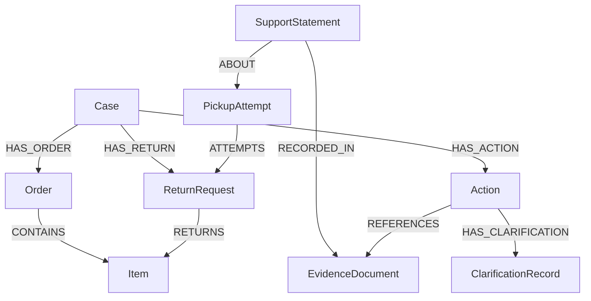

# ReturnTrail

**Keep every return claim connected to its source—and every follow-up connected to its reason.**

ReturnTrail is a synthetic e-commerce return investigation workspace built for
WeMakeDevs Graph Hacks with FalkorDB. Primary track: **Agents That Act on Connected Data**.

The current demo answers a narrow question: do records about the **same pickup
attempt** disagree about customer cancellation versus courier unavailability,
or explicitly omit the reason? A different attempt is not treated as a conflict.

## What works

- Four independent fictional cases in a session-isolated FalkorDB workspace.
- Lamp sign-in page with pull/click/keyboard control and readable on/off states.
- Optional Google OIDC or GitHub OAuth sign-in opens a persistent account-owned workspace;
  sign out and sign in again to resume saved context. Guest preview remains available.
- Source reader and comparisons limited to the selected pickup attempt.
- Actual query-matched evidence paths with directed relationships, alongside a
  separate illustrative 3D unboxing experience.
- Groq function-calling workflow reads evidence, saved notes and deterministic
  findings, then prepares a local follow-up only when pending.
- Atomic, repeatable task/source writes. Re-running does not duplicate a task.
- Explicit reply outcomes: **still unknown** keeps a task open; **explanation
  provided** records an unverified manual explanation and resolves that task.
- Reply request IDs prevent duplicate saves on identical retries. Changing an
  already-used reply payload or writing a new reply to a resolved task returns 409.
- Case-specific routes and guest graph isolation; case/task IDs alone grant no access.
- A version-checked case read, saved source/task/reply history and safe session recovery.
- Evidence Inbox: preserve original fictional text and an exact supporting quote,
  manually select its claim and owned pickup, review, then save an immutable source.
- Source-set revisions: new evidence can require fresh follow-up even after an
  earlier task was resolved. Earlier tasks and notes remain unchanged.
- A fresh case brief with original text, source paths, pending questions, task/note
  history and versions; download JSON or print/save PDF from the browser.
- 3D loads near the viewport, pauses offscreen/in hidden tabs, renders on demand
  after completion and shows at most six records including the selection.

No workflow sends a courier message, issues a refund or proves who was at fault.
A manually resolved task is not whole-case resolution.

## Try the four cases

| Case | Scenario | Initial result |
| --- | --- | --- |
| CASE-001 | Two different reasons for PICKUP-001 | One pending disagreement |
| CASE-002 | Different reasons for separate attempts A and B | No supported disagreement |
| CASE-003 | A record explicitly says no reason was recorded | One pending missing-context question |
| CASE-004 | A disagreement with a seeded manual reply | History remains; no pending task |

All records, notes and dates are synthetic. CASE-004 includes a prewritten example
reply, not a verification performed by a real courier. `NO_DISAGREEMENT_DETECTED`
means this bounded check found none; it is not confirmation that a return is valid.

## Run locally

Requirements: **Java 21+, Maven, Node 24/npm, Docker Compose**. If the Maven wrapper
is blocked on Windows, use an installed `mvn` as shown below.

From the repository root:

```powershell
docker compose up -d
```

Backend terminal:

```powershell
cd backend
mvn test
mvn spring-boot:run
```

Frontend terminal:

```powershell
cd frontend
npm.cmd ci
npm.cmd run dev
```

For saved sign-in, see [docs/LOGIN-SETUP.md](docs/LOGIN-SETUP.md) for OAuth app
setup and backend environment variables. Without them, guest mode still works.

Open **http://127.0.0.1:5174** and choose **Explore the demo case**. The case library
opens after explicit guest creation. Each guest is seeded automatically; no manual
development-graph seeding is needed. The Vite proxy sends `/api` to port 8085.
Read/proof/local task endpoints and the visible rule-review option work without a Groq key. To run AI, set `GROQ_API_KEY` in the backend terminal before starting it; see LOGIN-SETUP.md. Do not paste a placeholder as a real key.

After updating from the earlier single-case version, restart the backend and choose
**Start fresh demo**. Old guest workspaces are not migrated or overwritten in place.

## Graph model



`HAS_RETURN` establishes case ownership explicitly. The read query requires both
that ownership link and the return-to-item/order path, rather than assuming that
matching product IDs make two records part of the same case.

Queries are documented in [docs/GRAPH-QUERIES.cypher](docs/GRAPH-QUERIES.cypher).
The proof endpoint returns only the nodes/edges required by the executed MATCH,
not an invented map or a complete dump of the workspace.

## How the agent uses the graph

1. `get_case_evidence`: traverse the authorized case's graph and return source-linked claims.
2. `get_case_clarifications`: read saved manual notes and their task status at recording.
3. `get_case_findings`: apply bounded Java rules and account for linked resolved replies.
4. `prepare_followup_action`: only if pending; save/reuse a source-linked local task.

The server constrains tool order and exposes one required tool per call. Fresh
pending cases use four model requests; cases with no pending finding use three.
The model does not choose the workflow, generate arbitrary Cypher or determine
fault. The final report is rendered from tool results in Java. Original text stays in FalkorDB. Only compact IDs, claims and quotes are sent to
the model tool context. The Inbox uses manual labels; it does not perform AI
extraction, OCR or unrestricted file ingestion.

Removing FalkorDB removes the evidence traversal, saved action references, manual
context and proof paths. The frontend has no replacement case data source.

## API

Create the CSRF/session check with `GET /api/auth/csrf`, send its token as
`X-CSRF-TOKEN` on unsafe requests, then `POST /api/guest-sessions`. Preserve the
`RTSESSION` cookie. Account sessions use the same case APIs after verified sign-in.
See [docs/LOGIN-SETUP.md](docs/LOGIN-SETUP.md) for direct PowerShell examples.

| Method | Path | Result |
| --- | --- | --- |
| GET | `/api/auth/session` | Current account/guest status and sign-in availability |
| GET | `/api/auth/csrf` | Masked session check for unsafe requests |
| POST | `/api/auth/logout` | Sign out; saved account data remains |
| GET | `/oauth2/authorization/google` | Begin configured Google OIDC sign-in |
| GET | `/oauth2/authorization/github` | Begin configured GitHub OAuth sign-in |
| GET | `/api/cases` | Authorized guest's case library |
| GET | `/api/cases/{caseId}/snapshot` | Combined case read, findings, pending questions, tasks, notes and proof |
| POST | `/api/cases/{caseId}/evidence` | Save one reviewed synthetic text source |
| GET | `/api/cases/{caseId}/brief` | Fresh, version-checked structured case brief |
| GET | `/api/cases/{caseId}/context?exclude=DOC-001` | Read-only source-exclusion preview and saved task coverage |
| GET | `/api/cases/{caseId}/proof` | Query-derived evidence paths |
| GET | `/api/cases/{caseId}/evidence` | Original evidence |
| GET | `/api/cases/{caseId}/findings` | Historical findings, including explicit missing-context findings |
| GET/POST | `/api/cases/{caseId}/actions` | Read / prepare pending local tasks without calling a model |
| GET | `/api/cases/{caseId}/clarifications` | Saved manual notes |
| POST | `/api/cases/{caseId}/actions/clarification` | Explicit manual reply outcome |
| POST | `/api/cases/{caseId}/investigate` | Constrained Groq function-calling workflow |
| DELETE | `/api/guest-sessions` | End the guest session |

A clarification body must contain `actionId`, `note`, `outcome`
(`STILL_UNKNOWN` or `EXPLANATION_PROVIDED`), a UUID-v4 `requestId`, the task's 64-hex `evidenceRevision` and current case
`expectedVersion`. Reuse the
same ID only when retrying the exact same reply. Unknown replies retain their
original OPEN status even if a later explanation resolves the task.

Evidence capture requires `pickupId`, `sourceLabel` (80 characters), `sourceType`
(`COURIER_STATUS`, `SUPPORT_REPLY`, `CUSTOMER_NOTE` or `DEMO_NOTE`), `originalText`
(4,000 characters), exact `quote` (500 characters), `claimedStatus`
(`CUSTOMER_CANCELLED`, `COURIER_UNAVAILABLE` or `UNKNOWN`), `synthetic: true`, current
`expectedVersion` and UUID-v4 `requestId`. The entire JSON body is limited to
20,000 bytes and each case to 30 source records. No source is overwritten. A retry
with the same ID and contents returns the saved receipt; changed contents or a
stale new write returns 409. Import/task/reply writes share a 30-attempt/5-minute
budget per guest; this is separate from model-call limits.

## Validation

```powershell
cd backend
mvn test
cd ../frontend
npm.cmd run lint
npm.cmd run build
npm.cmd test
npx.cmd playwright install chromium
npm.cmd run test:browser
```

The browser contract suite mocks API responses. For real API/browser integration,
start the local backend and frontend, then run `npm.cmd run test:workspace` from
`frontend`. Run `npm.cmd run test:inbox` for source import, revision-aware tasks,
failed-read recovery and brief export. `npm.cmd run test:api` runs direct HTTP invariants against the running backend
(default http://127.0.0.1:8085; override `API_URL`). These create their own synthetic guests and use the deterministic task
endpoint; no paid/model calls are made. Stop other test runners to avoid rate limits.

[docs/WORKSPACE-VALIDATION.md](docs/WORKSPACE-VALIDATION.md) records verification,
limits and a demo checklist. Twenty manually labelled synthetic rule fixtures
live under `backend/src/test/resources/evaluation`; these are not a real-world
accuracy benchmark or LLM training dataset.

## Current boundaries

- Four seeded cases plus bounded fictional text additions to their existing
  pickups. No arbitrary file uploads, OCR or AI extraction. Saved accounts use
  optional Google OIDC or GitHub OAuth; no email OTP/password sign-in or automatic guest import.
- The supported disagreement is CUSTOMER_CANCELLED versus COURIER_UNAVAILABLE.
  Explicit UNKNOWN records can request missing context. Other status combinations
  are outside this detector's scope, not automatically verified.
- Guest sessions expire after two hours of inactivity. Backend restarts invalidate
  their in-memory sessions. Expired/orphan guest graphs are cleaned up; saved
  account graphs are retained while the database remains.
- Run one backend instance: the current session/lifecycle/rate-limit state is local.
  Do not scale replicas or share guest cleanup across independent deployments.
- Combined reads compare evidence/workflow versions before and after assembly,
  retry once, then return 409 if still changing. This guarantee covers application
  writes that update the counters; manual database edits bypass it. Individual
  evidence/task/reply mutations are single queries.
- No cloud deployment is included yet. Keep the UI/API on the same origin when deploying.
- Application health alone does not establish graph or Groq readiness.

## AI assistance

ChatGPT assisted with planning, code generation, interface design, tests and debugging.
The team runs, reviews and verifies the implementation and is responsible for
understanding and explaining the submitted code and graph model.

See [docs/EVIDENCE-WORKFLOW.md](docs/EVIDENCE-WORKFLOW.md) for the new workflow, performance changes, verification and remaining submission priorities.

Google-first authentication, lamp design and optional GitHub configuration are documented in [docs/LOGIN-SETUP.md](docs/LOGIN-SETUP.md). OAuth credentials stay in the backend environment.

## Context lab and current delivery update

- `/case/CASE-001/context`: read-only source exclusion with actual returned graph paths. It never deletes sources, resolves a task or verifies which claim is true.
- Saved task coverage shows which source set its manual notes reviewed and what was added later.
- Investigation offers an explicitly labeled rule review without model calls. AI investigation remains a separate configured operation.
- Case brief offers a source-linked fictional support draft; copying it does not send anything.
- Optional Google OIDC uses verified provider/subject identity, separate from GitHub and guest work. Email OTP is not implemented.
- The database-aware readiness endpoint is separate from liveness. Docker/HTTPS/CI source is included; actual deployment/hosted CI is not claimed.
- Public How it works/privacy pages and build-origin metadata/sitemap support discovery without exposing case data.

See [current update](docs/CONTEXT-UPDATE.md), [resource research](docs/RESOURCE-RESEARCH.md), [95+ acceptance gates](docs/QUALITY-GATES.md), [deployment](docs/DEPLOYMENT.md) and the [blank user observation sheet](docs/USER-VALIDATION.md). No invented user outcomes or accuracy/ranking scores are included.

## The people and the public demo

Om Singh Jadon and Ajeet Gadekar build across the frontend and backend. The landing page has a team preview; `/about` explains the idea, shows the team profiles and answers practical questions. Profile destinations and names live in `frontend/src/config/publicSite.js`.

The optional YouTube walkthrough stays hidden until a real `VITE_DEMO_VIDEO_URL` is configured. See [Team and video setup](docs/TEAM-POLISH.md), [photo preparation](docs/PHOTO-EDIT.md) and [current team-update validation](docs/TEAM-VALIDATION.md).
