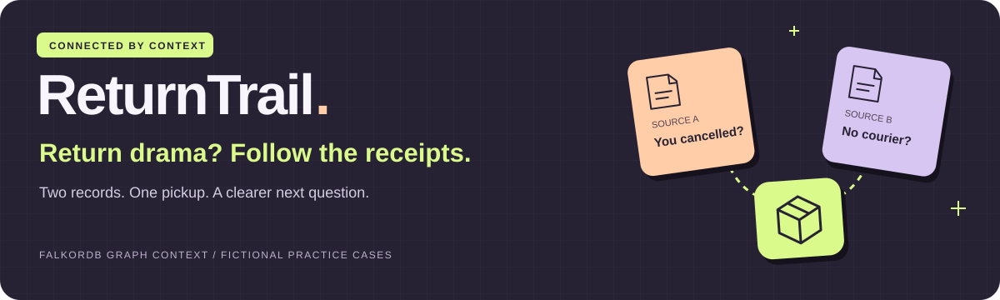
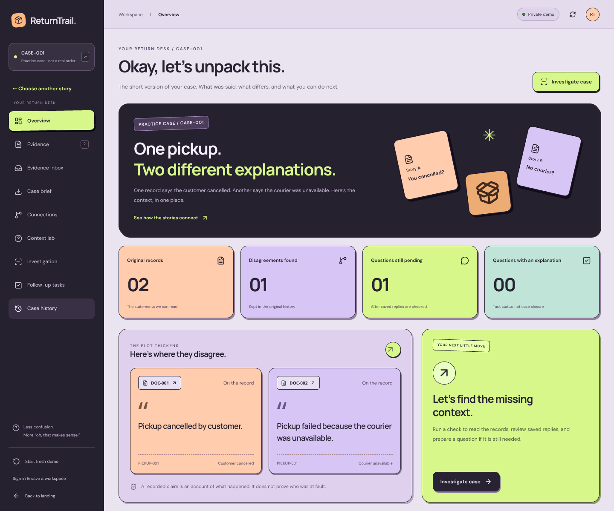
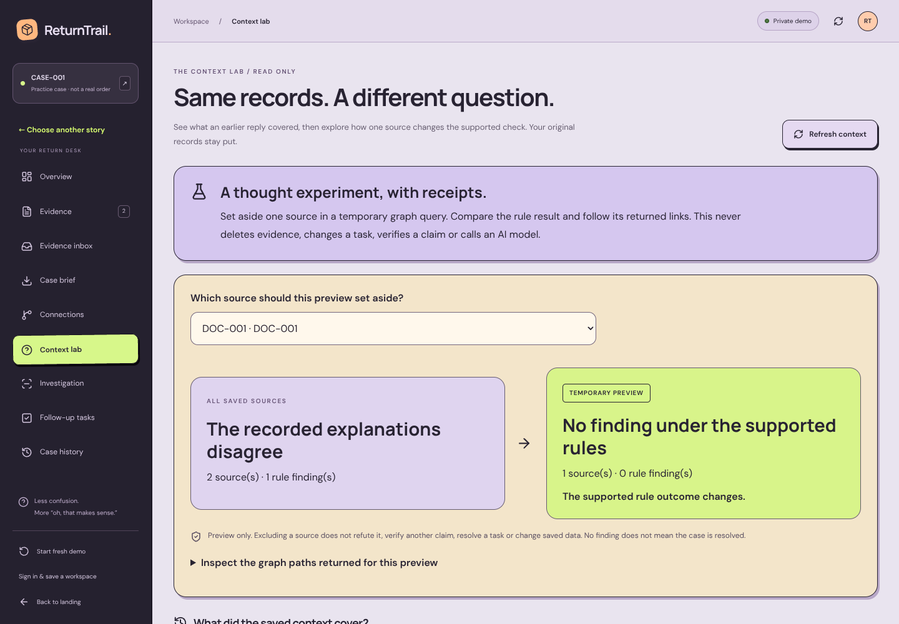
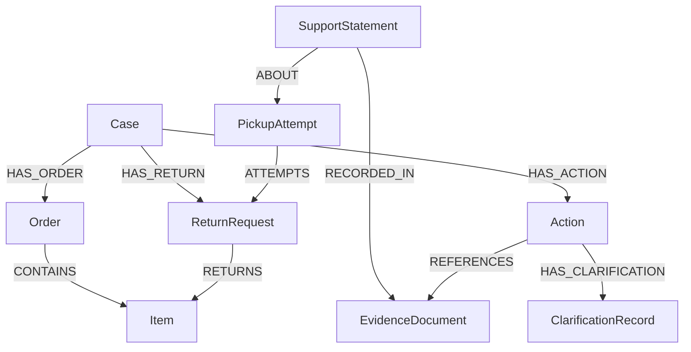
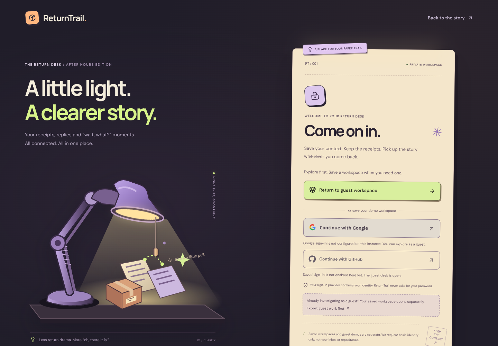

<p align="center">
  
</p>

<p align="center">
  <strong>Keep every return claim connected to its source.<br />Keep every follow-up connected to its reason.</strong>
</p>

<p align="center">
  <a href="https://returntrail-api.onrender.com">Open live demo</a> ·
  <a href="#try-the-demo">Demo walkthrough</a> ·
  <a href="#why-a-graph">Why a graph?</a> ·
  <a href="#run-locally">Run locally</a> ·
  <a href="docs/README.md">Documentation</a> ·
  <a href="#team">Meet the team</a>
</p>

<p align="center">
  <a href="https://github.com/OM2412/ReturnTrail/actions/workflows/verify.yml"></a>
</p>

<p align="center"><sub>Java 21 · Spring Boot · React · FalkorDB · Groq tool calling</sub></p>

ReturnTrail helps a shopper prepare an evidence-linked conversation about a disputed return pickup. Connect the original records, see what an earlier reply covered, and prepare the next support question with its sources attached.

**From conflicting records to a reviewable support brief:** compare claims → inspect their graph paths → prepare a follow-up → record a manual reply → export the brief.

Built for [WeMakeDevs × FalkorDB Graph Hacks](https://www.wemakedevs.org/hackathons/falkordb), under **Agents That Act on Connected Data**.

> **Practice data, clear boundaries.** This prototype uses fictional cases. A recorded claim is not proof of fault, and a resolved follow-up task does not establish whole-case resolution. No message is sent and no refund is issued.

## The problem

| What one record says | What another record says | What matters before answering |
| --- | --- | --- |
| “Pickup cancelled by customer.” | “Pickup failed because the courier was unavailable.” | Do both statements describe the **same pickup attempt**, and what did an earlier reply actually cover? |

For **CASE-001**, both records describe **PICKUP-001**. The app retains both claims and prepares: “Please confirm why pickup PICKUP-001 failed and explain the conflicting recorded reasons.” The resulting brief links back to the original sources. A later source can require fresh review even when an earlier task was resolved.

## Try the demo

**[Open ReturnTrail →](https://returntrail-api.onrender.com)**  
https://returntrail-api.onrender.com — choose **Explore as a guest**; no account or personal model key required.

> **Free preview:** Google/GitHub sign-in is configured; guest entry remains available. Render may need about a minute to wake after inactivity; backend restarts reset sessions. The free cloud database has no persistence or backups, so preview work can be lost. Use fictional data and export your brief. [Current hosting and limits](docs/DEPLOYMENT.md#current-public-preview).



<sub>Actual product capture with a fresh synthetic guest workspace and a local FalkorDB instance. No case API responses were mocked for these screenshots.</sub>

**A suggested 90-second walkthrough:**

1. Open [ReturnTrail](https://returntrail-api.onrender.com) and choose **Explore as a guest**. Alternatively, [run locally](#run-locally) at `http://127.0.0.1:5174`.
2. Open **CASE-001**. Compare the original words in **Evidence**, then inspect their returned source paths in **Connections**.
3. Open **Context lab** and set aside **DOC-001**. The supported rule outcome changes because only one recorded reason remains. The original evidence stays untouched.
4. In **Investigation**, choose **Review rules & prepare question**. This prepares or reuses a source-linked local follow-up without a model call.
5. Open **Follow-up tasks**. Record either **still unknown** or **explanation provided**, then inspect **Case history** and the fresh **Case brief**.

For a memory example, open **CASE-004**, add a reviewed fictional source through **Evidence inbox**, then revisit **Context lab**. The earlier task stays historical; the new source falls outside its reviewed source set and can require fresh follow-up.

<details>
<summary><strong>The four practice cases and their expected starting behavior</strong></summary>

| Case | Scenario | Initial supported result |
| --- | --- | --- |
| CASE-001 | Different reasons for the same pickup | One pending disagreement |
| CASE-002 | Different reasons for separate attempts | No supported disagreement |
| CASE-003 | A source explicitly says no reason was recorded | One pending missing-context question |
| CASE-004 | A disagreement with a seeded manual reply | History retained; no pending follow-up |

All records, dates and notes are fictional. CASE-004's seeded reply is an example, not an independently verified courier response. “No supported disagreement” describes this bounded rule check, not whether a return is valid.

</details>

**Demo video:** recording pending. The working guest preview is available above. Add the real walkthrough URL here after upload; the website's optional video section is configured through [video setup](docs/TEAM-POLISH.md).

## Why a graph?

**The graph changes what gets compared, what gets remembered and whether another question is needed.**

| Graph connection | Effect on the workflow |
| --- | --- |
| Case → order/item and case → return → item | Establishes the selected case's ownership through both required paths. Matching IDs alone do not grant access. |
| Statement → pickup attempt → return | Compares the same pickup attempt. CASE-002 demonstrates why a different attempt must stay separate. |
| Statement → original document | Returns the source path behind each recorded claim. The visible proof comes from the executed query. |
| Action → referenced documents → saved clarification | Shows which sources an earlier question and reply reviewed. New sources do not silently inherit that explanation. |

**Context lab** runs a parameterized, read-only source-exclusion query. It shows the remaining paths and the resulting bounded assessment. It does not delete evidence or decide which claim is true.



Removing FalkorDB removes the evidence traversal, returned proof paths and saved source/task/reply context. The frontend has no replacement case data source. The decorative 3D parcel experience is separate from the query-derived graph proof.

<details>
<summary><strong>Inspect the graph model</strong></summary>



The proof endpoint returns the paths required by the executed `MATCH`, not a full workspace dump. See [the documented Cypher queries](docs/GRAPH-QUERIES.cypher).

</details>

## A workspace with a purpose

<details>
<summary><strong>Explore the pages and their workflows</strong></summary>

| Surface | What you can do |
| --- | --- |
| **Overview & Evidence** | Read original claims and compare records about the selected pickup. |
| **Evidence inbox** | Review bounded fictional text, its exact supporting quote and a manually selected claim before saving an immutable source. |
| **Connections & Context lab** | Inspect returned evidence paths, preview source exclusion and check the coverage of saved explanations. |
| **Investigation & Follow-up tasks** | Review supported rules, optionally run the constrained AI workflow and save an explicit manual reply outcome. |
| **Case brief & History** | Prepare a source-linked fictional support draft, download JSON or print/save PDF, and inspect earlier tasks and notes. |
| **Guest & saved account** | Explore immediately as a guest. Google/GitHub account entry is configured on the public preview. Account work is separate from guest work and depends on the database being retained. |

</details>

<details>
<summary><strong>The lamp sign-in experience</strong></summary>



The lamp supports click, pull and keyboard interaction. Provider buttons depend on backend configuration. Guests can explore without an OAuth account; signing in does not automatically import guest work.

</details>

### Where the agent fits

When AI investigation is configured, the server enforces this sequence:

1. `get_case_evidence` — traverse the authorized graph for source-linked claims.
2. `get_case_clarifications` — retrieve saved manual notes and linked task context.
3. `get_case_findings` — apply bounded Java rules to the current source set.
4. `prepare_followup_action` — prepare/reuse a local task **only when a finding is pending**.

The model invokes the required tools; it does not choose an open-ended plan, generate arbitrary Cypher or determine fault. The final report is rendered from tool results in Java. The separate rule-review path works without a model key. These are application tool calls, not an MCP server.

## Run locally

**Requirements:** Java 21+, installed Maven, Node 24/npm and Docker Compose. Use global `mvn` if Windows blocks the Maven wrapper.

```powershell
git clone https://github.com/OM2412/ReturnTrail.git
cd ReturnTrail
```

From the repository root, start FalkorDB:

```powershell
docker compose up -d
```

In the backend terminal:

```powershell
cd backend
mvn test
mvn spring-boot:run
```

In a second terminal:

```powershell
cd frontend
npm.cmd ci
npm.cmd run dev
```

Open **http://127.0.0.1:5174**. Vite proxies the API and sign-in callbacks to Spring on **8085**; each new guest workspace is seeded automatically. No manual graph seeding is required. On macOS/Linux, use `npm` in place of `npm.cmd`.

| Optional capability | Configuration |
| --- | --- |
| AI investigation | Set `GROQ_API_KEY` in the backend environment before starting Spring. |
| Saved account | Configure Google OIDC or GitHub OAuth using [Login setup](docs/LOGIN-SETUP.md). |
| Hosting | [Current Render preview and deployment alternatives](docs/DEPLOYMENT.md); one backend instance is supported. |
| Video / public metadata | See [Team and video setup](docs/TEAM-POLISH.md) and `frontend/.env.example`. |

Keep OAuth secrets and model keys in backend environment variables, never frontend `VITE_*` settings. Without provider/model configuration, the guest reader, graph/context views and deterministic task workflow remain available.

## Validation

The [verification workflow](https://github.com/OM2412/ReturnTrail/actions/workflows/verify.yml) runs backend checks, frontend lint/tests/build and the mocked browser contract suite. The badge above reports its current result.

| Recorded check | Scope and evidence |
| --- | --- |
| **93 backend tests passed; 2 skipped** | [Hosted run at `275fb37`, 18 October 2026](https://github.com/OM2412/ReturnTrail/actions/runs/39101507785): 95 total, zero failures/errors, including the OAuth homepage regression checks. Two provider integration checks are opt-in. |
| **14 frontend Node tests passed** | Domain, source workflow, support draft and public-video input boundaries. |
| **23 browser contract groups passed locally** | Mocked API responses; these do not establish real backend or provider behavior. |
| **5 production integration groups passed locally** | Combined Spring JAR with actual FalkorDB, including guest entry and public/private route behavior. |
| **5 public API workflow groups passed** | Tested on the actual Render URL with managed FalkorDB on 18 October 2026; includes source writes, retry/version protection, history and separate guest isolation. |
| **Real hosted AI tool-calling check passed** | `openai/gpt-oss-120b`, 4 model requests, all 4 required tools in order, one OPEN local follow-up. [Public validation record](docs/PUBLIC-VALIDATION.md). |
| **Public OAuth configuration checked** | Both provider registrations are enabled and redirect to their real authorization endpoints with the exact public callbacks. Completed sign-in, logout and re-login still need real-browser acceptance. |
| **Landing/About accessibility scan** | Zero serious/critical axe findings in the tested desktop state; not a full accessibility certification. |

Current hosted evidence: [Public validation](docs/PUBLIC-VALIDATION.md). Earlier scoped checks: [Team](docs/TEAM-VALIDATION.md), [Context](docs/CONTEXT-VALIDATION.md), [Workspace](docs/WORKSPACE-VALIDATION.md). The twenty synthetic rule fixtures are a regression set, not a real-world accuracy benchmark. Human comprehension and commercial demand remain unvalidated; [the observation sheet](docs/USER-VALIDATION.md) is a blank research plan.

<details>
<summary><strong>Run the checks yourself</strong></summary>

```powershell
cd backend
mvn test
cd ../frontend
npm.cmd run lint
npm.cmd test
npm.cmd run build
npx.cmd playwright install chromium
npm.cmd run test:browser
```

With backend/frontend running, `test:workspace`, `test:inbox`, `test:context` and `test:api` exercise real local integration using their own synthetic guests. Run suites separately to avoid shared rate limits. These deterministic checks make no model calls. Real Google sign-in, uploaded-video playback and any new deployment need their own acceptance checks.

</details>

## Boundaries that matter

<details>
<summary><strong>Supported rules, session limits and deployment scope</strong></summary>

- **Focused prototype:** four seeded cases and bounded fictional text additions to existing pickups. No arbitrary uploads, OCR, AI extraction, courier integration or refund operation.
- **Explicit rule scope:** customer cancellation versus courier unavailability on the same pickup, plus explicit missing-reason records. Other status combinations are outside this detector's scope.
- **Evidence stays evidence:** a saved explanation is manually recorded and unverified. A resolved task is not case closure. Fresh sources can require fresh review.
- **Session and deployment limits:** guests expire after two hours of inactivity; backend restarts invalidate in-memory sessions. Saved account graphs persist while the database is retained. One backend replica is supported.
- **Bounded consistency:** combined reads check versions and retry once before returning 409. Manual database edits bypass application version counters. Health/readiness does not prove that Groq is available.

</details>

## Team

|  |  |
| :---: | :---: |
| **Om Singh Jadon** | **Ajeet Gadekar** |
| Full-stack developer | Full-stack developer |
| [GitHub](https://github.com/OM2412) · [LinkedIn](https://www.linkedin.com/in/om-singh-jadon-b92679314/) | [GitHub](https://github.com/AjeetGadekar) · [LinkedIn](https://www.linkedin.com/in/ajeet-gadekar-1b5692363/) |

Both teammates contribute across frontend and backend. Portrait preparation and the edited-image disclosure are recorded in [Photo preparation](docs/PHOTO-EDIT.md).

Chatgpt assisted with planning, implementation, debugging. The team is responsible for reviewing and verifying and coding the submitted work and explaining its code, graph model and technical decisions.

---

**Continue exploring:** [Documentation index](docs/README.md) · [API](docs/API.md) · [Graph queries](docs/GRAPH-QUERIES.cypher) · [Current validation](docs/PUBLIC-VALIDATION.md) · [Release checklist](docs/QUALITY-GATES.md)
